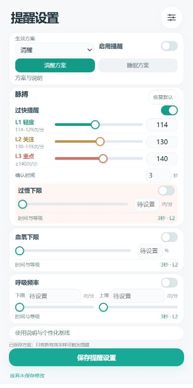
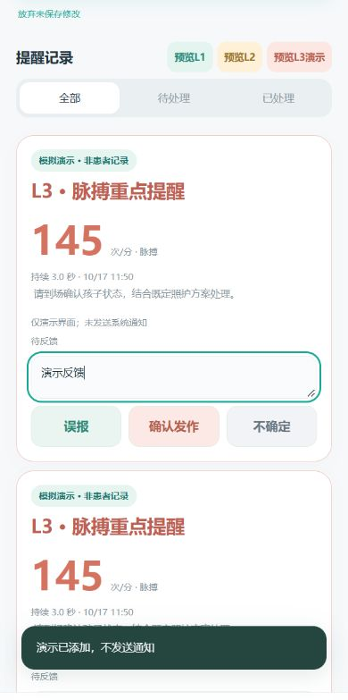

# DravetGuard · 夜间守护

Android腕表数据采集与家长提醒原型，当前展示版本 **0.9**。

> 工程原型，未经临床验证，不能用于诊断或排除发作。无数据、无提醒不表示安全。呼吸曲线明确标注模拟演示。

## 界面预览

| 可调提醒 | 提醒与人工反馈 |
|---|---|
|  |  |

## 主要功能

- 安卓BLE扫描、连接与状态展示；JX630脉搏、血氧手动测量及本地存储。
- 脉搏/血氧真实采样点与趋势折线；单次结果显示圆点，长间隔以虚线区分，不补造患者数据。
- 清醒与睡眠独立方案：脉搏过快、过慢、血氧下限、呼吸上下限可调；时间与L1/L2/L3级别可配置，保存后跨页同步。
- 脉搏过快默认114–129、130–139、≥140次/分，对应L1/L2/L3，默认同档新采样确认3秒。这是项目自定义提醒规则，不是儿童临床正常范围。
- L1在App记录，L2/L3请求安卓通知；能否实际送达受通知权限、通道及系统状态影响。
- 分色L1/L2/L3演示、备注，以及“误报 / 确认发作 / 不确定”人工反馈。确认发作仅表示人工记录。
- LD6002模拟呼吸卡片，不入真实患者记录、不上传、不触发报警。
- CSV回放、观察记录与Python开发服务；保留旧LD6004网关代码，不能据此声称LD6002已接通。

## 安装与运行

测试安装包：[DravetGuard 0.9 APK](releases/DravetGuard-Prototype-0.9.apk)。Android 8.0及以上，工程调试签名。0.9已完成编译、签名和界面检查，尚需真实手机回归；此前队友反馈JX630脉搏与血氧接收成功，不代表通用兼容所有Da Fit腕表。

### 安卓手机使用步骤

1. **下载安装包**：用手机打开仓库，进入 `releases` 文件夹，打开 `DravetGuard-Prototype-0.9.apk` 并下载。如果浏览器只显示文件信息，点击下载按钮或“View raw”。也可从电脑通过USB或文件传输把APK发送到手机。
2. **安装并打开**：点击下载好的APK，按手机提示允许当前浏览器或文件管理器安装应用，再完成安装。已有同签名版本可覆盖安装保留数据；遇到签名冲突请先备份需要的记录，不要直接卸载。当前版本为 `0.9-engineering`（versionCode 10），要求Android 8.0及以上。
3. **准备手环与权限**：给JX630充电、正常佩戴并靠近手机，打开手机蓝牙；按App提示允许“附近的设备/蓝牙”权限。旧版安卓扫描可能还需要定位权限及系统定位开关。先断开Da Fit、蓝牙调试工具等对手环的连接，避免占用连接。
4. **连接腕表**：打开App的“设置”，进入“蓝牙腕表”，点击“扫描附近蓝牙设备”，选择JX630并等待连接及服务准备完成。仅“已选择”不等于测量成功；应结合连接提示和采样时间确认。
5. **测量脉搏**：点击“启动一次脉搏测量”，保持正常佩戴，等待有效结果。回到“监护”查看脉搏数值与曲线。如果已有数据但首页未显示，检查“数据来源”是否选择手机蓝牙腕表。
6. **测量血氧**：脉搏测量结束或停止后，点击“启动一次血氧测量”，静止等待。每轮可能需要约一分钟，最长接收窗口约90秒；以实际设备结果为准。脉搏和血氧主动测量不能同时进行，测血氧时脉搏采集暂停。本版没有自动循环测量。
7. **查看趋势**：在“监护”或“观察”页面查看记录。一个结果只显示一个点，至少两个有效结果才可连线；多次测量间隔较长时显示虚线，不代表连续监测，也不会补造数值。
8. **设置提醒**：进入“报警”，分别编辑“清醒方案”和“睡眠方案”，拖动滑条或直接输入数值；展开“时间与等级”调整确认时间和L1/L2/L3。选择实际生效的清醒/睡眠状态，打开“启用提醒”，点击“保存提醒设置”。仅切换编辑页签不等于切换生效方案。脉搏过慢、血氧和呼吸阈值未设置时不能启用。
9. **允许通知**：需要L2/L3系统通知时，按提示允许通知权限，并在手机系统设置里确认本App通知通道、声音和振动可用。L1只在App记录。通知及后台送达需要在目标手机实测，本版不能保证锁屏时持续采样或送达。
10. **查看与反馈**：在“报警”的提醒记录中填写可选备注，点击“误报”“确认发作”或“不确定”。“确认发作”是家长人工记录，不是算法诊断。
11. **无硬件演示**：点击“预览L1”“预览L2”或“预览L3演示”体验提醒页面。这些仅演示，不发送系统通知，也不能用来验证通知送达。LD6002呼吸曲线始终是模拟展示，不需要连接真实雷达，不参与患者报警。

### 常见问题

- **扫描不到**：确认手环有电、手机蓝牙和所需权限开启，断开其他App后重新扫描。
- **已连接但没有数据**：连接不等于采样；启动一次对应测量，检查佩戴情况及页面状态。超时后可重新发起，并保存诊断信息用于适配。
- **血氧一直无结果**：确认没有同时运行脉搏测量，保持佩戴稳定，等待本轮结束。不要把缺失值当作正常值。
- **规则没有触发**：检查总开关、生效方案、保存状态和数据来源；确认时间需要不同的新有效采样，旧值不会重复计时。血氧每轮通常只有一个结果，非零确认时间可能无法满足连续采样条件；0秒表示单次新结果判断。
- **无通知**：先查看App内是否有提醒记录，再检查系统通知权限和通道。页面演示本身不发送通知。

手机直接蓝牙采样与查看不要求部署电脑服务。跨房间蓝牙覆盖、后台采样和通知效果需现场验证，WiFi正常不代表蓝牙链路正常。

真实雷达未接入，个性化基线推荐未实现。血氧/过慢/呼吸的新阈值默认未设置并关闭，需确认后启用；持续时间规则需要不同新采样，不能用缓存值补足。

## 源码结构

- `android/`：Java17、原生Android与本地HTML界面。
- `prototype/`：Python开发API、网关、CSV解析、合成测试与测试代码。
- `docs/screenshots/`：0.9界面预览，提醒截图使用明确标注的演示记录。
- `releases/`：0.9测试APK。

## 重新构建

Windows安装Python3.11+及JDK17后，在项目根目录运行：

```powershell
python Build-Prototype-Apk.py --jdk "C:/path/to/jdk-17"
```

脚本从Google官方下载并校验Android工具，输出到`outputs/apk/`；首次构建生成本机调试签名。本公开包不含原签名密钥，自行构建包不能覆盖不同签名的已安装版本。也可按`android/README.md`使用Gradle工程。

Python服务：

```powershell
cd prototype
python server.py
```

硬件网关依赖与串口参数见`prototype/README.md`。这是开发服务，云端部署和AI医疗判断未作为已完成能力交付。

## 检查

```powershell
node android/tests/chart-checks.cjs
node android/tests/adjustable-ui-checks.cjs
node android/tests/radar-demo-checks.cjs
node android/tests/ble-ui-checks.cjs
```

## 数据与许可

本仓库包不包含患者CSV、运行数据库、访问令牌、签名私钥或本地设备缓存。请勿提交真实患者数据。

项目源码尚未指定开源许可证；公开展示不等于已授予开源授权。发布者选定许可证后再补充LICENSE。第三方文件保留其原有许可，例如Gradle Wrapper许可文件。
