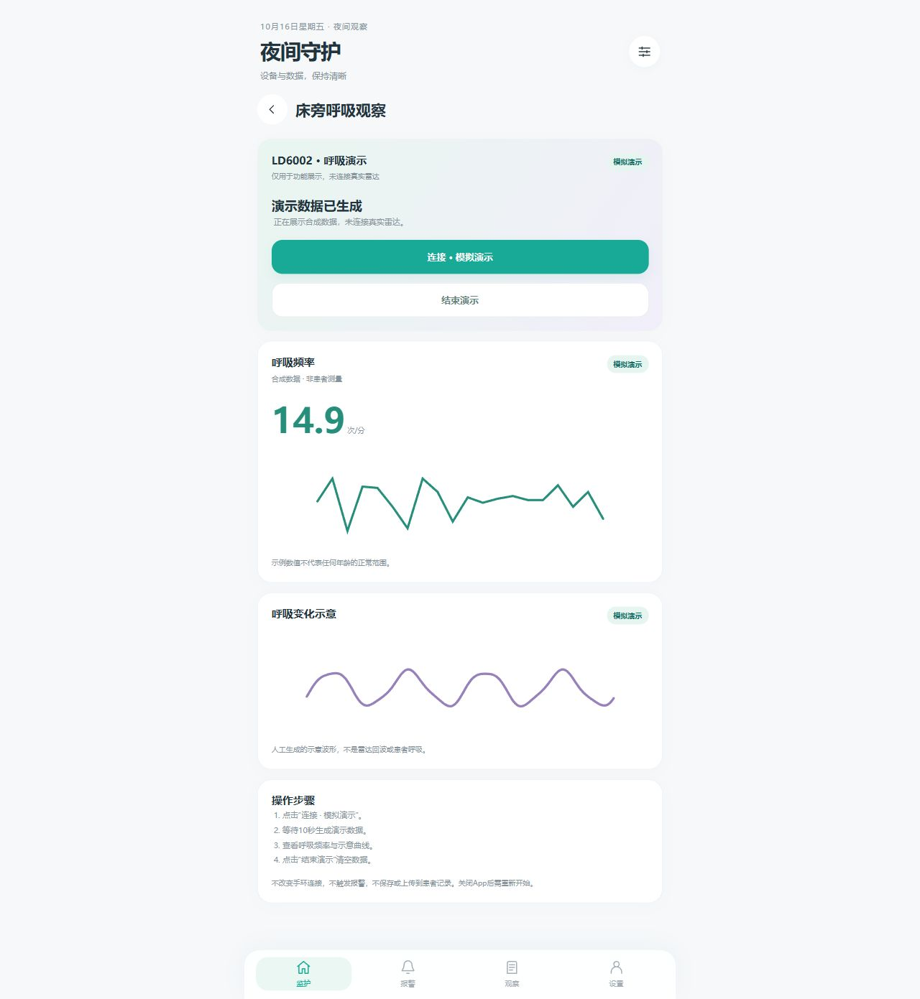

# DravetGuard · 夜间守护

Android 腕表数据采集与家长观察记录原型。当前公开展示版本 **0.6**。

> 工程原型，不是医疗器械或癫痫诊断系统。雷达呼吸界面为明确标注的合成演示；没有数据或没有提醒不代表患者安全。

## 已实现

- **安卓BLE采集**：扫描、连接、服务发现、通知订阅、连接状态与数据新鲜度展示。
- **JX630脉搏与血氧**：Moyoung私有测量命令、标准2A37脉搏、FEE3帧重组、测量互斥、90秒超时及本地诊断导出。项目测试设备已反馈脉搏和血氧可接收；不代表所有Da Fit腕表通用兼容。
- **脉搏分级提醒**：用户配置规则为114–129 / 130–139 / ≥140次/分，分别对应L1/L2/L3；同档由不同新采样确认至少3秒。L1仅App记录，L2/L3请求系统通知。这是项目自定义规则，不是儿童临床正常范围。
- **本地记录**：SQLite、CSV回放、数据趋势、人工观察和提醒反馈。
- **LD6002呼吸演示**：点击演示连接后等待10秒，展示标记为模拟数据的频率与示意曲线。模拟数据不入患者记录、不上传、不触发报警。
- **Python开发服务**：本地API、鉴权、历史记录、LD6004串口网关及合成数据工具。

## 范围说明

| 项目 | 当前情况 |
|---|---|
| 安卓版本 | minSdk26 / targetSdk35，仍需各机型实测 |
| 实物测试腕表 | JX630，MOYOUNG-V2；软件MOY-JK62-2.0.5 |
| 测量方式 | 单次手动脉搏 / 血氧；两项不能并行 |
| 血氧报警 | 未启用，当前只展示数据 |
| LD6002真实接入 | 未实现，当前仅演示 |
| LD6004网关 | 保留旧串口适配；不能作为LD6002协议使用 |
| 可拖动多指标阈值、低脉搏提醒、个性化基线 | 后续设计，不包含在0.6实现中 |
| 自动发作识别 / 临床验证 | 未实现 / 未完成 |
| 正式云部署、跨家庭权限、稳定锁屏送达 | 尚未验收 |

## 演示预览

下图为浏览器界面预览，非真实患者数据或安卓硬件测量截图。



## 目录

```text
android/                    安卓工程、UI和协议测试
prototype/                  Python服务、串口网关及测试
Build-Prototype-Apk.py       SDK工具构建脚本
Setup-Gateway.ps1            网关依赖安装
Start-Server.ps1             启动开发服务
docs/                       合成演示预览与协议说明
```

## 运行

Python 3.11+：

```powershell
python -m unittest discover -s prototype -p "test*.py"
.\Setup-Gateway.ps1
.\Start-Server.ps1 -Live
```

首次启动在`prototype/runtime/`生成访问码和本地数据库。该目录不应提交。网关参数见[网关说明](prototype/README.md)。

Android：使用Android Studio打开`android/`，准备JDK17、SDK35后构建debug版本，详见[安卓说明](android/README.md)。仓库不提供签名私钥；自行构建使用自己的调试签名，不能保证覆盖项目此前分发的APK。

```powershell
cd android
.\gradlew.bat :app:assembleDebug
```

## 隐私与数据

不包含真实患者CSV、健康数据库、访问码、BLE实测日志、开发者签名密钥或内部项目记录。CSV请使用自行生成的合成数据测试。不要将可识别健康记录提交到Issues或仓库。

## 第三方与许可

本项目按协议事实独立实现适配逻辑，不集成Da Fit APK或厂商SDK。Gradle Wrapper的Apache-2.0许可证与校验说明见[声明](android/GRADLE-WRAPPER-NOTICE.md)。Python外部依赖按各自许可证分发。本仓库的开源许可待项目所有者确认；在确认前属于公开源码展示，不应视为已授予任意再许可权限。图标及其他视觉素材的权利归各自权利人。
